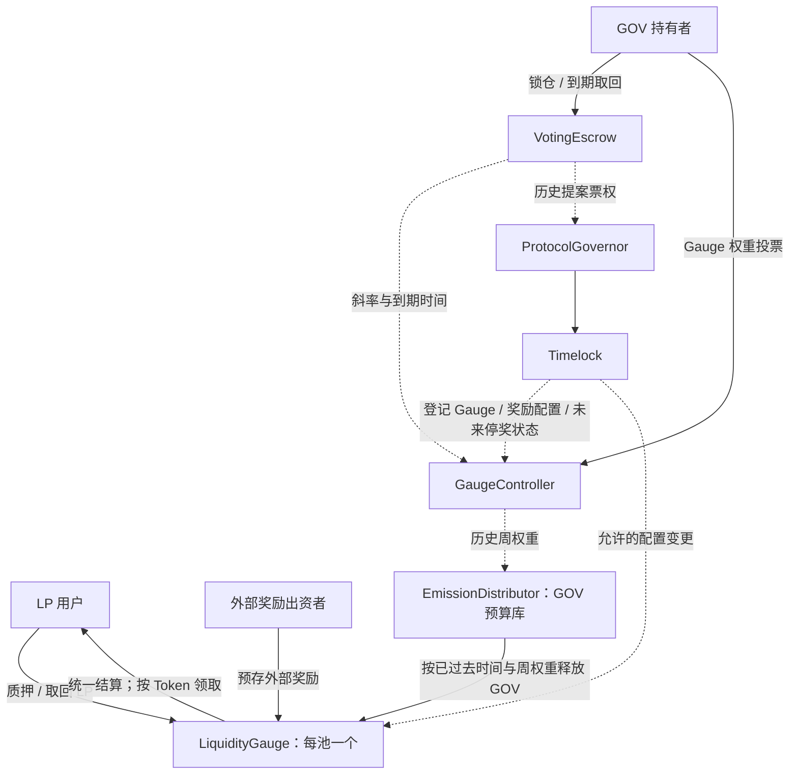

# Curve-Style Staking

一个借鉴 ve 锁仓与 Gauge 激励机制的单链 DeFi 智能合约项目，支持 LP 质押、多 Token 奖励、GOV 锁仓、Gauge 权重投票及受限协议治理。

## 目录

- [1. 功能范围](#scope)
- [2. 架构与资金流](#architecture)
- [3. 代币经济与奖励发行](#tokenomics)
- [4. ve 锁仓](#ve)
- [5. Gauge 权重与池间分配](#weights)
- [6. LP 质押与奖励分配](#staking)
- [7. 协议治理与权限](#governance)
- [8. 合约与调用关系](#contracts)
- [9. 安全与验证要求](#validation)
- [10. 最小交互演示](#demo-ui)
- [11. 工程结构与工具](#engineering)
- [12. 部署与验收](#deployment)
- [13. 开发阶段](#stages)
- [14. 参考与许可](#references)

<a id="scope"></a>

## 1. 功能范围

- 两个 LP 池对应的 Gauge，使用同一种 LiquidityGauge 实现。
- LP 质押、追加质押、部分退出、全部退出、奖励查询与领取。
- 单一质押余额，多种奖励 Token 独立记账，共用奖励积分算法。
- GOV 原生预算按时间释放，按已生效的 Gauge 权重分配。
- 外部奖励由指定出资者预存，按计划释放，不受 Gauge 投票改变。
- GOV 锁仓、追加锁仓、延长期限、到期取回及历史 ve 查询。
- Gauge 权重投票、多池 BPS 分配、下周生效、改票限制和到期衰减。
- 与 Gauge 投票分离的协议提案、历史快照表决、Timelock 延迟执行。
- 本金隔离、预算约束、权限控制、分批结算及自动化验证。

<a id="architecture"></a>

## 2. 架构与资金流



| 资产 | 路径与记账变化 |
|---|---|
| LP 本金 | 用户 → 对应 Gauge；质押余额增加。退出时余额减少，LP 返回本人 |
| 锁仓 GOV | 用户 → VotingEscrow；记录数量、结束时间、历史点。到期取回本人 |
| 原生奖励 GOV | 部署时预存 EmissionDistributor → 按区间释放到 Gauge → 记用户应得 → 领取时转给本人 |
| 外部奖励 Token | 出资者 → Gauge → 排定释放周期 → 记用户应得 → 领取时转给本人 |

GaugeController 只管权重；ve 本身不保管第二份本金。各 Gauge 的 LP 和奖励账目互相隔离。

普通转账到合约地址不自动构成 stake 或奖励注资。直接多出的 LP 不创建份额，直接多出的奖励不追溯增加过去收益。

<a id="tokenomics"></a>

## 3. 代币经济与奖励发行

### GOV 用途与来源

GOV 是本项目自己的 ERC-20：用于锁仓获取 ve，也用于 LP 原生奖励。不承诺持币利息、独立锁仓发币或费用分成。

两类奖励共用“累计应得后转账领取”的路径，GOV 在部署时一次性发行，之后不开放增发：

| 参数 | 本项目默认设定 |
|---|---|
| GOV 精度 | 18 位小数 |
| 初始流通/演示分配 | 1,000,000 GOV，接收地址列入部署配置 |
| 原生奖励储备 | 208,000 GOV，开始前足额转入 EmissionDistributor |
| 固定总发行量 | 1,208,000 GOV |
| 每周全系统预算 B | 1,000 GOV |
| 发行周期 W | 604800 秒，统一 Unix 周 |
| 奖励计划长度 | 208 周 |
| 奖励起点 | 指定未来周起点，且必须完成预算入库与初始化 |
| 全系统参考速率 | B / W，使用精确分数语义，不先截断成整数速率 |
| Gauge 当周速率 | 该池当周预算 / W |
| 错过的原生额度 | 空池、零权重、停奖对应额度保留在预算库，不补发给后来者 |

预算库只释放既定计划内的额度。额外捐入 GOV 不延长发行计划。不提供任意取走未释放预算的管理入口。

原生预算按周独立计算，精确公式见 [Gauge 投票规范](docs/GAUGE_VOTING.md#emissions)。外部奖励由实际注资支持，与 GOV 储备分开核对。

<a id="ve"></a>

## 4. ve 锁仓

- 每地址一份锁仓，支持创建、追加数量、延长期限、到期取回。
- 最长锁期为 4 × 365 天，结束时间向下对齐整周，且对齐后仍须晚于当前时间。
- 不允许提前退出、缩短期限、转让或委托 ve。
- 保存个人与全局历史检查点，提供严格过去时刻的权益查询。
- 锁仓到期后先取回，再创建新锁仓；过期配置的 Gauge 撤票有独立清理路径。

经济定义：

```text
ve(user, t) = lockedAmount × max(lockEnd - t, 0) / MAX_LOCK_TIME
```

实现使用统一高精度 slope、bias 和到期变化记录，不遍历所有用户。ve 变动不会自动改写已提交的 Gauge 投票，用户需重新投票；也不会改写既有提案的历史快照。

<a id="weights"></a>

## 5. Gauge 权重与池间分配

Gauge 投票只决定**原生 GOV** 在池子间的分配：

1. 用户锁 GOV 获得 ve。
2. 按 BPS 分配给不同 Gauge，总分配不超过 10000。
3. Controller 记录投票斜率、到期时间及下一周的待生效变化。
4. 到下一周起点，按有效历史记录确定该周权重。
5. EmissionDistributor 按该周权重计算各 Gauge 预算。
6. Gauge 在补账时领取已过去区间对应的 GOV，再通过统一积分分给 LP 用户。

核心约定：

| 项目 | 规则 |
|---|---|
| 周起点 | floor(timestamp / WEEK) × WEEK；区间采用 [start, end) |
| 新票/改票生效 | 下一周起点，不改变当前或历史周 |
| 同用户同 Gauge 改票间隔 | 十天，撤票也遵守；首次投票无需等待 |
| 权重更新 | 按周确定；无需每周重投，但已投绝对票权随锁期衰减 |
| 增加/延长锁仓 | 需重投才应用新增能力 |
| 总权重为零 | 无原生分配，不自动平均分 |
| 总票权分母 | 当周已取得资格的 Gauge 权重总和 |
| 停奖 | 治理安排下一周生效，保留其权重分母，对应额度不释放；不自动转给别池 |
| 外部奖励 | 完全不读取 Gauge 相对权重 |
| 历史结算 | 使用对应历史周权重，不用当前权重补算过去 |

例如某周 A/B 权重为 40/60，则预算为 400/600 GOV；新投票生效后为 70/30，才对新周使用 700/300。其间仍按用户实际参与时段结算。

投票字段、权重计算、到期变更、归一化及延迟补账规则见 [Gauge 投票规范](docs/GAUGE_VOTING.md)。

<a id="staking"></a>

## 6. LP 质押与奖励分配

每个 Gauge 只有一套 `balanceOf[user]` 和 `totalStaked`。GOV 和每种外部奖励分别保存自己的累计积分及用户应得值，不创建第二套 Staking 余额。

| 核心字段 | 含义 |
|---|---|
| totalStaked / balanceOf[user] | 全池 / 个人实际质押 LP |
| rewardPerTokenStored[token] | 每单位 LP 累计获得该奖励的高精度积分 |
| userRewardPerTokenPaid[user][token] | 用户已结算到的积分位置 |
| rewards[user][token] | 已结算、尚未领取的整单位奖励 |
| lastUpdateTime[token] | 该奖励已经推进到的时间 |
| globalRemainder / userRemainder | 统一精度下尚不能整除的全局/个人余数，禁止重复分配 |
| streamBudget / periodStart / periodFinish | 外部奖励本次预算与释放起止时间 |
| totalFunded / totalPaid / totalAllocated | 实际注资、实际支付、进入用户分配的总量 |

原生奖励的新增量来自“时间 × 当周 Gauge 预算”；外部奖励的新增量来自其自己的预算释放曲线。新增量确定后共用：

```text
积分增量 ≈ 本次新增奖励 × PRECISION / totalStaked
个人新增奖励 ≈ balanceOf[user] × (最新积分 - 个人已结算积分) / PRECISION
```

以上为经济概览。实现必须使用 [完整整数公式](docs/REWARD_ACCOUNTING.md#kernel)，保留全局与个人余数，并在质押人群变化前封存旧全局余数。

操作顺序统一为：**补算全部奖励 → 结算本人历史 → 按入口规则核验转账并变更余额或领取记录。** 余额变化前封存旧全局余数；存入先核验实际到账再加质押余额，退出和领取先更新应扣记录再转出，失败整笔回退。

| 操作 | 注释 |
|---|---|
| 首次质押 | 新 LP 不参与进入前的历史奖励 |
| 追加质押 | 旧数量先结算，新增数量从本次操作后参与 |
| 部分退出 | 原数量先结算，剩余数量继续参与 |
| 全部退出 | LP 余额归零，已赚奖励及个人小数余数保留，可之后领取 |
| 领取某奖励 | 更新后只转该 Token，不改质押本金；可结算其他 Token，但不清空或支付其应得余额 |
| 外部续资 | 先结旧计划；未来剩余预算、新资金及可重排储备形成新计划，不能重用已欠用户的金额 |
| 空池 | 原生额度留在预算库；外部已过时间的预算进入该 Token 未分配储备，不直接赠予首位后来者 |

支持一个原生奖励和最多八种外部奖励，循环次数固定有界。LP 仅支持登记的普通十八位 ERC-20，奖励支持独立精度的普通 ERC-20；拒绝 rebasing、转账扣费、回调等非标准行为，注资须检查实际到账。奖励 Token 不得与任何登记 LP 重合，外部奖励不得使用 GOV。

示例：

外部奖品 R 七天发 840，每天 120：

- A 第 0 天存 100。
- B 第 1 天加入 100。
- A 第 2 天加到 200。
- A 第 3 天取回 100。
- B 第 4 天全部取回。
- A 第 5 天全部取回。

前五天最终 A 赚 440，B 赚 160；后两天没人参与，240 留为外部未分配储备。440 + 160 + 240 = 840。A、B 退出后仍可领取此前赚到的部分。

字段单位、完整算法、所有操作伪代码、续资公式、数值示例及会计恒等式见 [奖励核算规范](docs/REWARD_ACCOUNTING.md)。

<a id="governance"></a>

## 7. 协议治理与权限

两类投票必须独立：

| 项目 | Gauge 权重投票 | 协议治理提案 |
|---|---|---|
| 目的 | 分配各池原生预算 | 批准登记与配置操作 |
| 发起条件 | 有有效锁仓，可分配自己的 BPS | 满足提案门槛 |
| 计票依据 | 投票 slope、到期日，按周衰减 | 提案固定历史 ve 快照 |
| 是否需要通过门槛 | 不需要多数通过，自行配置个人支持比例 | 需要法定票数与赞成结果 |
| 生效 | 下一周更新权重 | 通过 → 排队 → 等待 → 执行合约调用 |
| 执行者 | Controller 的确定性计算 | Governor + Timelock |
| 能否直接取钱 | 不能 | 权限范围内也不能提取用户本金或任意预算 |

协议治理默认采用：一天投票延迟、七天表决、两天 Timelock；提案门槛为创建前一秒总 ve 的 1%，法定票数为快照总 ve 的 4%，均向上取整且至少一最小单位。赞成票多于反对票，且赞成与弃权合计达到门槛才通过。总 ve 为零时不能零票通过。

Governor 使用自定义 ve 历史查询，时钟统一为 timestamp。不假设 VotingEscrow 是普通 ERC20Votes，不混用区块号与时间戳。

Timelock 可登记 Gauge、配置外部奖励及出资者、安排未来停奖、恢复新存款；Guardian 只能暂停新存款，不能提款、改票、改变预算或阻止已有用户领取。更多权限及函数见 [合约说明](docs/CONTRACTS.md#permissions)。

<a id="contracts"></a>

## 8. 合约与调用关系

| 模块 | 主要职责 |
|---|---|
| GOVToken | 部署时固定发行，无后续增发入口 |
| VotingEscrow | 锁仓本金、ve 计算、个人/全局历史 |
| GaugeController | Gauge 登记、投票、历史周权重与停奖计划 |
| EmissionDistributor | 保管原生预算、按历史区间释放、记录游标与未释放额度 |
| LiquidityGauge | 单一 LP 质押及多 Token 奖励；每池独立实例 |
| RewardAccounting 库 | 无托管权限的统一整数积分和用户结算逻辑 |
| ProtocolGovernor | 历史 ve 提案表决，衔接 Timelock |
| TimelockController | 复用治理延迟执行组件 |

|常见函数| 主要职责 |
|---|---|
| stake / withdraw | 存入 / 取回 |
| exit | 全部取回 |
| claim | 领取奖励 |
| checkpoint | 补全账单 |
| fundReward | 注资 |
| voteForGauge | 分配池子比例 |
| propose | 发起提案 |
| castVote | 投票提案 |

正常资金操作的核心调用为：

```text
用户 → Gauge.stake / withdraw / claim
     → Gauge._checkpointAll(now)
       → EmissionDistributor.pullNative(toTime)
         → GaugeController 历史周权重
       → 每种奖励的 RewardAccounting.accrue
     → RewardAccounting.settleUser
     → 本次余额或支付操作
```

每个模块的拟定函数、调用者、资金边界、依赖和部署顺序见 [合约与权限说明](docs/CONTRACTS.md)。

<a id="validation"></a>

## 9. 安全与验证要求

重点验证资金和时间，不以页面数量或覆盖率数字代替正确性。

- 本金足额：Gauge 的 LP 余额不低于 totalStaked，锁仓 GOV 不低于未取回本金。
- 单用户投票分配不超过 10000 BPS，已结束周不可被改写。
- 原生释放总量不超过计划，外部承诺有实际注资支持。
- 多 Token 互不串账，重复领取不重复支付。
- 所有余额变动先结历史；全部退出不吞掉奖励。
- 用独立参考模型验证积分、余数、累计预算及权重，给出可复现数值。
- 对不同小数位、零余额、周期边界、到期、续资、直接捐赠、失败转账及重入做正反测试。
- 检查点按周分批推进；资金操作不能跳过未完成历史。先公开 checkpoint，再重试操作。
- 新存款暂停不影响按规则退出；withdraw 不强制转出奖励，坏的外部奖励转账不连带阻断 LP 转出。
- 不提供任意资产 rescue、任意外部 call 或代理升级。

验证要求见[奖励核算规范](docs/REWARD_ACCOUNTING.md#verification) 和 [Gauge 投票规范](docs/GAUGE_VOTING.md#verification)。

<a id="demo-ui"></a>

## 10. 最小交互演示

需完成：连接钱包、LP 授权与存取、按 Token 领奖、GOV 锁仓、Gauge 投票，以及一条协议提案流程。显示余额、可领值、当前/下周权重和生效时间即可。

<a id="engineering"></a>

## 11. 工程结构与工具

计划使用 Solidity 0.8.28、Foundry、固定版本的 OpenZeppelin Contracts；以 Forge 单元、集成、Fuzz、状态不变量测试及独立参考模型为主。实施时锁定依赖提交和编译配置。

当前文件为一份 README 与 docs 内设计文档；下列代码目录是待建立的目标：

```text
src/       token、ve、controller、distributor、gauge、governor、interfaces、奖励库
test/      unit、integration、invariant、reference、mocks；可选 fork
script/    部署、初始化、演示
frontend/  可选最小演示页面
```

代码完成后在项目目录执行：

```sh
forge build
forge test -vv
forge test --gas-report
forge coverage
```

<a id="deployment"></a>

## 12. 部署与验收

部署脚本应顺序完成：

固定 GOV 发行 → 部署 ve、Controller、Distributor → 奖励储备入库 → 创建两个 Gauge → 初始登记与投票 → 设置治理与角色 → 移交 Timelock → 激活未来发行计划。地址、网络、配置、代码版本和预算核对结果写入部署清单。

至少演示以下闭环：

1. Alice 质押，Bob 中途加入；验证早晚参与的历史奖励。
2. Alice 追加、部分退出、全部退出；奖励仍可随后领取。
3. 两种外部奖励与 GOV 同时累计，领取互不影响。
4. Carol 锁 GOV，投票把 A/B 分为 40/60；下一周按此预算累计。
5. 达到改票间隔后改为 70/30，旧周不变，新周生效。
6. 外部续资与空池时段不挪用已赚奖励。
7. 单独完成登记或配置提案的表决、等待及执行，证明它与 Gauge 投票不同。
8. 暂停新存款后仍能按规则退出；长期闲置后可分批补账。
9. 核对 LP 本金、锁仓本金、原生储备及每种外部预算。

<a id="stages"></a>

## 13. 开发阶段

| 阶段 | 交付重点 |
|---|---|
| 基础 Staking | 单 Gauge、多 Token 共用核算、全部存取领取路径、预算与精度测试 |
| ve 锁仓与 Gauge 投票 | 历史 ve、周权重、两个 Gauge、原生预算按时间和权重接入 |
| 治理与完善 | 独立协议提案、Timelock、权限交接、完整测试和最小演示 |

<a name="references"></a>

## 14. 参考与许可

- [Curve Gauge 概览](https://knowledge.curve.finance/protocol/gauge/overview)
- [Curve VotingEscrow](https://docs.curve.finance/developer/curve-dao/voting-escrow/admin-controls)
- [Curve GaugeController](https://docs.curve.finance/developer/gauges/gauge-controller)
- [Curve LiquidityGaugeV6](https://knowledge.curve.finance/developer/gauges/gauges/liquidity-gauge-v6)
- [OpenZeppelin Governance](https://docs.openzeppelin.com/contracts/5.x/api/governance)

本项目仅借鉴 ve 与 Gauge 机制；按实际 LP 统一分奖、固定预存预算及范围取舍均属于自身设计，不声称与原版 Curve ABI 或经济参数兼容。
